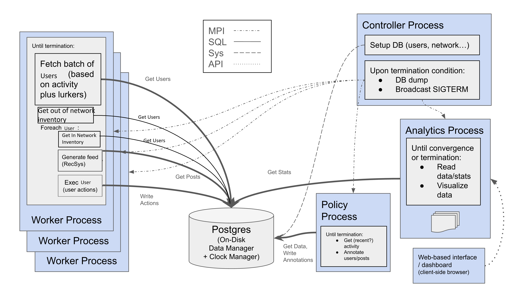
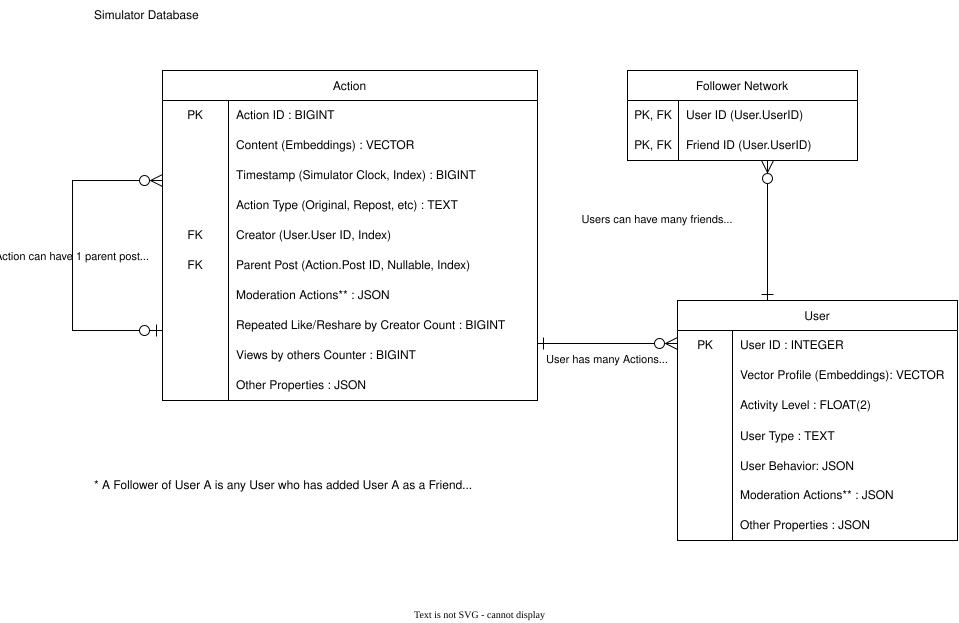

<!--
Copyright © 2026 The Trustees of Indiana University and contributors.
This work is licensed under the Creative Commons Attribution-NonCommercial 4.0 International License (CC BY-NC 4.0).
You may use, share, and adapt this work for non-commercial purposes, subject to the terms of the license and appropriate attribution.
See the LICENSE file in the root of this repository for the full license terms.
https://creativecommons.org/licenses/by-nc/4.0/
-->

# SimSoM NGen

## Overview

SimSoM NGen (Simulator of Social Media: The Next Generation) models the spread of and exposure to information across a simulated social media platform, such as Twitter/X, Mastodon, Bluesky, Threads, or Instagram.  It applies agent-based modeling techniques to incorporate diverse features and affordances of platforms and their users, such as moderation policies, the network structure of online communities, and the use of ranking/recommendation algorithms. It builds upon the earlier [SimSoM](https://github.com/osome-iu/SimSoM) simulator developed by OSoMe researchers and used in [previous research](https://doi.org/10.1093/pnasnexus/pgae258). SimSoM NGen is redesigned from the ground up to be more scalable, customizable, and ecologically valid. 

SimSoM captures the network that users form on a platform by friending or following each other. These social connections may or may not be reciprocal. Researchers can use empirical networks derived from social media data, or generation models to create synthetic networks with desired properties, like hubs, clustering, communities, and homophily. 

Information circulates through messages that appear on user news feeds. Users may post new messages; and/or like, reshare, quote, or reply to content from their feed. The simulation also includes lurkers, who consume information but do not interact with it. 

In real-world social media, messages take the form of text, links, hashtags, images, or other media. In the simulation, we use embedding vectors to represent the semantics of such content, as well as user interests. Content can also carry variables representing features like quality and appeal, drawn from researcher-specified distributions. 

A recommendation system creates an algorithmic feed for each user, with a parametric mix of in-network content (from the user’s friends) and out-of-network content (other topically relevant posts). Researchers can customize the recommendation system to include ingredients such as recency, relevance, general appeal, and popularity/engagement, as well as control the relative importance of these factors. 

SimSoM can model different groups of users – for example, regular people and inauthentic or malicious accounts. Each group can be customized for features like activity distributions, network characteristics, and types of different content generated. For example, one might want to model an information operation spreading harmful or illegal, but engaging content. All these properties can be calibrated using empirical data.

The simulator includes a policy module that models machine learning or human moderation, based on researcher-defined platform policies. These could include, for example, removal or down-ranking of content that is deemed to violate platform policies. Such content may be detected with delays according to researcher-defined distributions. 

The model tracks not only actions but also exposure to each piece (and type) of content. An analytics module lets researchers customize which statistics are reported. For example, one might wish to study how different moderation policies affect exposure to illegal content. Researchers can also specify criteria for simulations to stop, based on a fixed (simulated) time or a steady state having been reached. For example, the simulation might stop when a quantity of interest (say, content quality) has converged. 

## Technical Overview

This repository contains the current simulator scaffold. The active design uses
[mpi4py](https://mpi4py.readthedocs.io/en/stable/overview.html) for process
coordination and a Postgres-backed data model for shared state.

The current implementation is organized around four process roles plus a shared
database:

- `Controller`: setup DB state, monitor termination, dump DB, and coordinate
  shutdown messages and acknowledgments
- `Worker`: claim batches of users, generate feeds, execute user actions, write actions
- `Policy`: read recent activity and write moderation actions
- `Analytics`: evaluate recurring outputs and termination criteria at configured
  simulation-progress checkpoints
- `Postgres`: shared state plus DB-owned simulator clock semantics

The simulator is designed to support runs with up to 1,000,000,000 users.
User identifiers use PostgreSQL `INTEGER`; the storage type permits IDs up to
2,147,483,647, but one billion users is the intended supported scale.

The code under `libs/simsom/` defines process boundaries, DB contracts, and
subcomponent seams so multiple team members can work in parallel without all
modifying the same files.

### Current Status

The current design reflects the latest DB-backed architecture. The shared DB
boundary, process coordination, clock path, policy loop, analytics loop, feed
ranking, and user-action path are implemented. Remaining work is mainly model
expansion and larger-scale validation:

- the MPI entry point and rank layout are wired up
- the DB-facing contracts are defined around `user`, `action`, `follower_network`,
  and shared lifecycle state
- the controller and worker orchestration paths coordinate through the shared DB boundary
- policy, analytics, RecSys, and user behavior run through DB-backed process loops
- the DB clock lives in Postgres through the required `simsom_clock` extension
  under `libs/simsom/db/clock/`
- action rows use the DB-owned `timestamp` column; workers omit simulator
  timestamps on insert

If you are looking for the design intent rather than just the code, start with:

- `docs/logical_architecture/logical_Architecture.md`
- `docs/algorithms/simulation.md`
- `docs/algorithms/database.md`
- `docs/algorithms/domain_activity.md`
- `docs/algorithms/controller.md`
- `docs/algorithms/worker.md`
- `libs/simsom/`

### Architecture

The logical target architecture of the system is illustrated in the following diagram:



Where the entity relationship is shown in the following diagram:



The surrounding design notes are in:

- `docs/logical_architecture/logical_Architecture.md`

### Repository Layout

The main simulator scaffold lives under:

- `libs/simsom/components/`: MPI process orchestration
- `libs/simsom/db/`: DB boundaries and shared DB core contracts
- `libs/simsom/subcomponents/`: team-owned behavior contracts
- `libs/simsom/config/`: simulator configuration
- `docs/logical_architecture/`: architecture and ER diagrams

### Planned Work

The remaining design work is focused on:

- expanding the user and content models beyond the current implementations
- calibrating action rates, termination behavior, and large simulations
- defining future user-focused policy behavior
- hardening end-to-end simulation coverage around the DB-backed process flow

### Known Limitations

- **Deterministic randomness**: exact repeatability across distributed processes
  is not currently implemented. We can revisit this later if reproducible runs
  become a core requirement.

## Usage

Choose manual PostgreSQL deployment or Docker Compose. Manual setup requires
installing the extension on your database server; the provided Docker image
handles that installation during its build. Both use the same per-run setup.

### Docker

Install [Docker Desktop](https://docs.docker.com/desktop/) on macOS, Linux, or
Windows, or [Docker Engine](https://docs.docker.com/engine/install/) with the
Compose plugin on Linux. Then make sure the Docker daemon is running and
reachable from your terminal:

```bash
docker info
```

Common local setup notes:

- macOS: install and start Docker Desktop. From Terminal, `open -a Docker` is a
  convenient way to launch it.
- Linux: use Docker Engine with the Compose plugin or Docker Desktop for Linux.
  If your Engine install requires elevated access, configure your user for Docker
  or run the Docker commands with `sudo` consistently.
- Windows: use Docker Desktop, usually with the WSL 2 backend. Run the commands
  from PowerShell, Windows Terminal, Git Bash, or a WSL shell after Docker
  Desktop reports that the engine is running.

To customize a local run, edit
`libs/simsom/config/default_simulator_config.jsonc` before starting Compose.
The `--build` flag below rebuilds the simulator image with those changes.

Then run this from the repository root:

```bash
docker compose up --build --abort-on-container-exit --exit-code-from simulator
```

Compose builds and starts both parts required by the current simulator:

- PostgreSQL 18 with the `simsom_clock` extension compiled and installed
- the Python simulator with MPI, `psql`, and `pg_dump`

No local Python, MPI, Conda, or Postgres installation is needed. Logs and
JSONL files are saved in `output/logs/` on the host; the final database dump
is saved in `output/`. The Postgres data is kept in
a named Docker volume, while each simulator run resets the `simsom` schema as
it does when run natively.

#### Inspecting simulation results

The live database contains the most recent simulation run. After the simulator
finishes, start just the database service in the background:

```bash
docker compose up -d database
```

Then open an interactive Postgres prompt inside the container:

```bash
docker compose exec database psql -U simsom -d postgres
```

Stop the background database service when finished inspecting it:

```bash
docker compose stop database
```

Each `output/simsom_dump_<timestamp>.sql` file is a separate
plain-text snapshot of one run. Dump files do not add data to one another, and
the live database is reset when another simulation starts. A dump can be read
directly with a text viewer, for example, you can view the latest dump by:

```bash
less "$(ls -t output/simsom_dump_*.sql | head -n 1)"
```

SQL dumps remain in `output/` after containers are stopped or removed. When a
snapshot is no longer needed, delete that specific file, for example:

```bash
rm output/simsom_dump_YYYYMMDD_HHMMSS.sql
```

To stop the services, or remove the containers after a completed run:

```bash
docker compose down
```

To also delete the persisted database volume and start completely fresh:

```bash
docker compose down --volumes
```

On macOS Docker Desktop, if Compose fails with
`docker-credential-desktop: executable file not found in $PATH`, add the Docker
Desktop helper binaries to your shell `PATH`:

```bash
export PATH="/Applications/Docker.app/Contents/Resources/bin:$PATH"
```

If you need this every time, add the same `export` line to your shell startup
file, then rerun the normal Compose command.

Arguments after the service name are passed to the existing simulator runner.
For example, to override the MPI process count:

```bash
docker compose run --rm simulator --num-procs 6
```

### Manual installation

#### Preparation

These instructions use a manually managed PostgreSQL server, which may run
locally or on a remote host. Install the simulator environment on the machine
that will run SimSoM and install the clock extension on the database server.

Create the conda environment:

```bash
conda env create -p ./venv -f environment.yml
```

```bash
conda activate ./venv/
```

##### (Linux/macOS) Prepare Postgres before running the simulator with conda:

*Note: These instructions may also work on Windows but this remains untested by the development team.*

1. PostgreSQL can be installed locally without the need for root permission by using conda.
   ```bash
   conda install postgresql==18.4 # other versions may work
   ```

2. Ensure that the `simsom_clock` extension files are installed to the conda PostgreSQL 
   server installation. You might might need to install `gcc` and `gxx` for this to compile,
   if you do not already have compatable compilers installed. If you are on macOS, you may 
   already have compilers installed via Xcode Command Line Tools and attempting to install
   `gcc` and `gxx` via conda will return an error.
   ```bash
   conda install gcc gxx # optional
   make -C libs/simsom/db/clock
   make -C libs/simsom/db/clock install
   ```

3. Prepare and start a local PostgreSQL server.
   ```bash
   mkdir tempdb # on both linux and macos
   initdb -D tempdb 
   pg_ctl -D tempdb -l logfile start
   # after running the simulation, stop the server with pg_ctl -D tempdb stop
   ```

### Start the simulation

To start the simulator from the repository root:

```bash
python libs/simsom/run_simulation.py
```

The runner derives its default MPI process count from
`libs/simsom/config/default_simulator_config.jsonc`.

Press `Ctrl-C` to interrupt a run. The runner forwards the interruption to the
MPI process group, waits for it to exit, and prints the log location without a
Python traceback.

The runner also prints the locations of two run-local JSONL files:

- `termination_metrics.jsonl` contains one flushed lightweight termination
  record per simulation-progress checkpoint.
- `analytics_output.jsonl` contains recurring and final configured analytics
  function outputs.

Relative paths are resolved under the configured `system.log.path`. Both files
are truncated when the simulation starts, and final analytics outputs are also
stored in `analytics_summary.other_properties.analytics_outputs`.

#### Default output locations

These paths use the default config and commands run from the repository root.
Compose mounts the host's `output/` directory at `/output/output/` inside the
simulator container, so Docker and local runs use the same host artifacts.

| Output | Manual run | Docker Compose run |
|---|---|---|
| Process log | `output/logs/simsom.log` | `output/logs/simsom.log` |
| Setup progress | `output/logs/setup_status.jsonl` | `output/logs/setup_status.jsonl` |
| Termination checks | `output/logs/termination_metrics.jsonl` | `output/logs/termination_metrics.jsonl` |
| Recurring and final analytics | `output/logs/analytics_output.jsonl` | `output/logs/analytics_output.jsonl` |
| Final SQL dump, when enabled | `output/simsom_dump_<timestamp>.sql` | `output/simsom_dump_<timestamp>.sql` |

When `controller.dump_on_termination` is enabled, the controller also writes a
plain SQL schema dump. The export omits source ownership and privilege
statements, so another PostgreSQL role can restore it without needing the
original owner's role:

```bash
psql -X -d postgres -f output/simsom_dump_YYYYMMDD_HHMMSS.sql
```

SQL dumps are retained in `output/` after a manual run. When a snapshot is no
longer needed, delete that specific file, for example:

```bash
rm output/simsom_dump_YYYYMMDD_HHMMSS.sql
```

To use a different simulator config:

```bash
python libs/simsom/run_simulation.py --simulator_spec /path/to/config.jsonc
```

Current default config:

- `libs/simsom/config/default_simulator_config.jsonc`

> [!TIP]
> If you get system prompt asking incoming network connections permission for `python`, click `Allow`. This is essential for MPI to work properly.
>
> 


### Verification

Run the minimal unit-test suite from the repository root:

```bash
./venv/bin/python -m unittest discover -s tests -v
```

Run a compile check for simulator code and tests:

```bash
./venv/bin/python -m compileall -q libs/simsom tests
```

These tests cover shared DB contracts, component-boundary activity/action
semantics, controller setup, setup dataset planning, worker DB behavior, and
worker loop orchestration. Clock-extension regression SQL lives under
`libs/simsom/db/clock/sql/`, with optional local Postgres integration coverage
in `libs/simsom/tests/test_simsom_clock.py`. There is not yet a dedicated
end-to-end simulation test suite.


### Inspect simulation data in Postgres

The database connection and schema are configured in
`libs/simsom/config/default_simulator_config.jsonc` under `database`:

```json
"database": {
    "dsn": "postgres",
    "schema": "simsom"
}
```

The default database is `postgres` and the default simulator schema is
`simsom`. A custom simulator config may use a different database or schema.
Connect with the same database settings used by the simulator:

```bash
psql -X -d postgres
```

Inside `psql`, list the simulator schema and its tables:

```sql
\dn
\dt simsom.*
```

Inspect a table's columns, types, indexes, and constraints:

```sql
\d+ simsom.user
\d+ simsom.action
\d+ simsom.follower_network
\d+ simsom.simulation_lifecycle
\d+ simsom.analytics_summary
\d+ simsom.simsom_clock_state
```

Check row counts and the current simulation lifecycle state:

```sql
SELECT 'users' AS table_name, count(*) FROM simsom."user"
UNION ALL
SELECT 'actions', count(*) FROM simsom.action
UNION ALL
SELECT 'friend_links', count(*) FROM simsom.follower_network
UNION ALL
SELECT 'analytics_summaries', count(*) FROM simsom.analytics_summary;

SELECT *
FROM simsom.simulation_lifecycle
WHERE lifecycle_id = 1;
```

Inspect user behavior and action properties, including content quality,
appeal, post labels, moderation annotations, and parent links:

```sql
SELECT user_id, user_type, activity_level,
       jsonb_pretty(user_behavior) AS user_behavior,
       jsonb_pretty(other_properties) AS other_properties
FROM simsom."user"
ORDER BY user_id
LIMIT 10;

SELECT action_id, creator_user_id, action_type, timestamp,
       parent_action_id,
       jsonb_pretty(content_embedding) AS content_embedding,
       jsonb_pretty(moderation_actions) AS moderation_actions,
       jsonb_pretty(other_properties) AS other_properties
FROM simsom.action
ORDER BY action_id DESC
LIMIT 10;
```

Inspect friend links:

```sql
SELECT user_id, friend_id
FROM simsom.follower_network
ORDER BY user_id, friend_id
LIMIT 20;
```

Inspect the latest analytics result:
```sql
SELECT analytics_summary_id, recorded_at, user_count, action_count,
       avg_action_quality, termination_criteria, other_properties
FROM simsom.analytics_summary
ORDER BY analytics_summary_id DESC
LIMIT 1;
```

To leave `psql`, run `\q`. The simulator keeps these rows in Postgres after a
run ends. The next simulation setup clears run data and loads a fresh dataset.

## Contact

For any questions or bug reports, please submit a GitHub Issue.

## License

Copyright © 2026 The Trustees of Indiana University and contributors.

Except where otherwise noted, the materials in this repository are licensed under the **Creative Commons Attribution-NonCommercial 4.0 International License (CC BY-NC 4.0)**.

Subject to the terms of the license, you may use, share, and adapt the licensed materials for non-commercial purposes, provided that appropriate attribution is given.

**Commercial use is not authorized under this license.** If you wish to use this software or any portion of it for a commercial purpose, please contact the Indiana University Observatory on Social Media at [osome.iu.edu/about/contact](https://osome.iu.edu/about/contact) to discuss separate licensing or obtain permission.

The full license terms are available in the `LICENSE` file and at:
https://creativecommons.org/licenses/by-nc/4.0/

Please note that “NonCommercial” has the meaning assigned to that term in the CC BY-NC 4.0 license. The license terms, rather than this summary, control in the event of any inconsistency.

## Citation

If you use this software in academic or research work, please cite the software as:

```
Sarah Beverton, Shalmoli Ghosh, Silvia Giordano, Sangyeon Kim, Nick Liu, Filippo Menczer, Gianluca Nogara, Ben Serrette, Bao Tran Truong, Enrico Verdolotti, Lake Yin. "SimSoM NGen.", Version 1, 2026. GitHub repository: https://github.com/osome-iu/simsom-ngen.
```

## Support

This research was funded by the Swiss National Science Foundation (SNSF), Grant No. CRSII5_209250, the U.S. National Science Foundation, Award No. BCS-2444659, and the Knight Foundation.

Any opinions, findings, and conclusions or recommendations expressed in this material are those of the authors and do not necessarily reflect the views of the funders.

## Contributors

### Code

- [Sarah Beverton](https://github.com/sarahbeverton)
- [Shalmoli Ghosh](https://github.com/shalmolighosh)
- [Nick Liu](https://github.com/nick-c-liu)
- [Gianluca Nogara](https://github.com/gi-ux)
- [Enrico Verdolotti](https://github.com/3rr4t1c)
- [Lake Yin](https://github.com/LakeYin)

### Additional

- Alessandro Flammini
- Silvia Giordano
- Natascha Just
- Sangyeon Kim
- Filippo Menczer
- Florian Saurwein-Scherer
- Ben Serrette 
- Bao Tran Truong
- Caitlin Watkins
