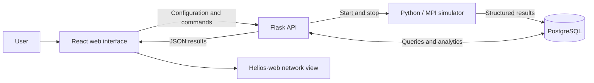

# Simulation GUI: Initial Requirements

**Status:** First-pass proposal  
**Purpose:** Identify a reasonable starting point for a GUI before its final
design and requirements are known.

## Goal

Create a web interface that allows a user to configure and run a social-media
simulation, monitor its status, and review basic results. This is an initial
requirements list and will change as we learn more about the simulator and its
users.

## Inputs

The first version should consider the following inputs.

### Basic run settings

- Number of simulator processes or workers.
- A button to start the simulation.
- A button to stop a running simulation.
- An option to use the default simulator configuration.

### Population settings

- Number of normal users.
- Number of adversarial or bad users.
- Percentage of users who are inactive or primarily observe.
- Basic user-quality distribution settings.

### Behavior settings

- Likelihood or frequency of creating a post.
- Likelihood or frequency of liking, replying, reposting, and quoting.
- Feed size and candidate-pool sizes.
- Ratio of in-network to out-of-network content.

### Policy and completion settings

- Whether content-moderation policy is enabled.
- Quality threshold for intervention.
- Conditions that determine when the simulation should stop.
- Whether to save or dump final simulation data.

The interface should provide safe defaults so a user can run a simulation
without understanding every advanced parameter. Advanced inputs can be hidden
in an expandable section.

## Outputs and Visualizations

The first version should display a small set of understandable results.

### Run information

- Current status: ready, running, stopping, complete, or failed.
- Start time, completion time, and elapsed time.
- Clear validation and runtime error messages.
- A limited console or log view for troubleshooting.

### Summary results

- Total number of users.
- Total number of actions.
- Average number of actions per user.
- Average content or action quality.
- Whether the simulation converged and why it stopped.
- Basic policy coverage and intervention statistics.

### Charts

- Action count over time.
- Breakdown of posts, likes, replies, reposts, and quotes.
- Quality or policy measurements over time.

### Network visualization

Use **Helios-web** to display the social network in 3D:

- Users are nodes.
- Posts or interactions are edges between users.
- Node color represents user type.
- Edge color represents interaction type.
- Selecting a node displays basic user information.
- Selecting an edge displays information about the interaction or post.
- Filters allow the user to highlight particular user and interaction types.

### Downloads

- A readable HTML or PDF-style summary report.
- Analytics data as CSV.
- Network nodes and edges as CSV.
- Complete results as JSON.

## Interaction With the Simulator

The browser should not run the simulator directly. A backend API should manage
the simulator process.

The initial workflow could be:

1. The React interface requests default configuration values from the backend.
2. The user reviews or changes the inputs and clicks **Run**.
3. React sends the configuration to the Flask API as JSON.
4. Flask validates the configuration and starts the Python simulator.
5. The simulator writes structured results to PostgreSQL.
6. React periodically requests status and analytics from Flask.
7. Flask reads structured results from PostgreSQL and returns JSON.
8. React displays metrics and charts and sends network data to Helios-web.
9. The user can stop the run or download its results.

Logs should be used for troubleshooting. Charts and reports should use
structured simulator output rather than trying to extract data from log text.

## Initial Architecture

### Proposed technology choices

- **React:** Configuration forms, run controls, charts, and result panels.
- **Flask:** Validation, API routes, simulator process management, and result
  queries.
- **PostgreSQL:** Structured simulation state and analytics.
- **Helios-web:** Interactive 3D network visualization.
- **Python simulator:** Existing simulation and MPI execution logic.

This architecture is sufficient for an initial local prototype. A future
public system may require authentication, a job queue, multiple simultaneous
runs, durable run history, resource limits, and isolated storage for each run.

## Initial Questions

- Who is the primary user of the first interface?
- Which simulator settings must be exposed, and which should remain advanced?
- Which measurements are most important for interpreting a run?
- Do users need live results, or are final results sufficient?
- How large will typical networks and simulations be?
- Will users need to compare multiple runs?
- What information may be downloaded or shared publicly?

## First-Pass Completion Criteria

This initial requirements exercise is complete when:

- Candidate inputs have been listed.
- Candidate outputs and visualizations have been listed.
- The basic interaction between the GUI and simulator has been described.
- React, Flask, PostgreSQL, and Helios-web have been identified as the initial
  architecture.
- Open questions have been recorded for later requirements work.
