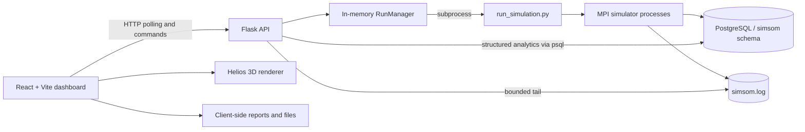
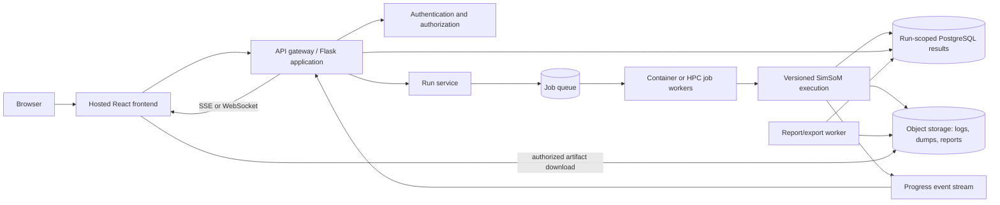

# Web Interface: First-Pass Requirements and Architecture

**Status:** Initial requirements draft  
**Last updated:** August 19, 2026  
**Scope:** The existing local SimSoM dashboard and its likely evolution into a
larger public-facing system

## 1. Purpose

SimSoM needs a graphical interface that lets a user configure and run a
simulation, monitor its progress, inspect its results, and export data for
further analysis. The final public interface is not yet defined, so this
document records a first-pass set of requirements based on:

- The task's stated closure criteria.
- Inputs and outputs supported by the simulator today.
- Capabilities already demonstrated by the prototype in this directory.
- Requirements that will become important when the local, single-user
  prototype becomes a shared public system.

These requirements are deliberately provisional. They should be validated
with researchers, analysts, and intended public users before being treated as
a final product specification.

## 2. First-Pass Scope

The first interface should allow a user to:

1. Start one simulation from safe defaults or validated configuration changes.
2. See whether the simulation is queued, running, stopping, complete, or
   failed.
3. Monitor a small set of scientifically meaningful metrics during and after
   the run.
4. Explore the resulting user-interaction network.
5. Inspect diagnostic output without treating logs as analytics.
6. Download readable and machine-readable results.

The current prototype is local and single-user. Authentication, multiple
simultaneous jobs, durable run history, resource scheduling, and public data
governance are target-system requirements rather than claims about the current
implementation.

## 3. Inputs

### 3.1 Minimum required input

At the interface level, the user should not be required to understand or edit
the simulator's JSONC file. A valid run requires:

- An MPI process count. The current accepted range is 4–64 and the UI default
  is 8.
- A complete simulator configuration. The interface supplies the canonical
  default configuration and sends only validated overrides when the user
  changes advanced settings.

Consequently, a user can start a default run without changing any fields. The
system—not the user—is responsible for supplying all required default values.

### 3.2 Current run-configuration inputs

The prototype exposes the following inputs. These form the initial candidate
set; they are not necessarily the final public terminology or grouping.

| Group | Inputs | Current validation or interpretation |
| --- | --- | --- |
| Execution | MPI process count | Integer from 4 through 64 |
| Population | Normal-user count; adversarial-user count | Nonnegative integers; total population must be greater than zero |
| Participation | Normal and adversarial lurker ratios | Values from 0 through less than 1 |
| User quality | Quality-distribution weight and lambda slope for each user type | Weight from 0–1; positive slope |
| Feed construction | Feed size; in-network inventory; out-of-network inventory; in-network ratio | Inventory must be at least the feed size; ratio from 0–1 |
| Candidate lookback | Engagement lookback as a population multiplier | Positive number |
| Action behavior | Mean and standard deviation for like, post, repost, reply, and quote | Two nonnegative numbers per action type |
| Worker execution | Worker batch size; action insert chunk size; idle sleep | Positive batch/chunk sizes; nonnegative sleep |
| Policy | Enabled state; quality threshold; batch size; polling interval | Threshold from 0–1; batch is `-1` or positive; nonnegative interval |
| Analytics | Analytics polling interval | Nonnegative interval |
| Termination | Stop at the maximum average actions per user; stop on quality convergence | At least one stopping or convergence criterion must remain enabled |
| Completion | Dump database on termination | Boolean |

This is 30 visible run controls: the process count plus 29 editable
configuration values. Infrastructure values such as the database DSN, schema,
executable paths, and PostgreSQL binary are intentionally server-side settings
and must not be arbitrary browser inputs.

### 3.3 Analysis and visualization controls

These controls do not change the simulation. They change how results are
explored:

- Filter/highlight nodes by user type, with additive selection.
- Filter/highlight edges by interaction type, with additive selection.
- Adjust the force-layout link distance.
- Adjust node-size and edge-thickness rendering scales.
- Rotate, pan, and zoom the 3D network.
- Select a node or edge to inspect its attributes.
- Select an export format.

### 3.4 Likely future inputs

The public system will probably require the following additions. These remain
open requirements until confirmed with stakeholders:

| Candidate input | Why it is needed | Priority |
| --- | --- | --- |
| Run/scenario name and description | Makes saved runs understandable and shareable | High |
| Random seed | Required for reproducibility and controlled comparisons | High |
| Saved configuration template | Supports repeatable experimental designs | High |
| Simulator/code version | Prevents comparisons across incompatible implementations | High |
| Resource or cost limit | Protects a shared system from unbounded jobs | High |
| Output sampling/detail level | Controls database, network, and download size | Medium |
| Baseline run for comparison | Enables comparative analysis rather than isolated inspection | Medium |
| Imported network or initial dataset | Supports studies beyond synthetic defaults | Medium, subject to governance |
| Visibility and sharing setting | Controls private, team, or public access to a run | High for public deployment |

## 4. Outputs and Visualizations

### 4.1 Run state and feedback

The interface must display:

- Run state: idle, queued in a future shared system, running, stopping,
  completed, or failed.
- Start and completion times, return status, and run identifier.
- Validation errors in terms the user can act on.
- Whether analytics or network data is unavailable, still loading, or
  truncated.
- A clear distinction between simulator results and diagnostic output.

### 4.2 Summary outputs

The current prototype demonstrates these first-pass summary outputs:

| Output | Current presentation | Purpose |
| --- | --- | --- |
| User count | Summary metric | Confirms simulated population size |
| Action count | Summary metric | Shows total generated activity |
| Average action quality | Summary metric and signal | Tracks the primary quality outcome |
| Average actions per user | Summary metric | Normalizes activity by population |
| Convergence state and reason | Status indicator | Explains whether and why the model converged |
| Policy coverage | Signal/bar | Shows how much eligible content was evaluated |
| Policy intervention ratio | Signal/bar | Shows frequency of policy action |
| Software and simulated runtime | Context list | Separates compute time from modeled time |
| Average friends/followers per user | Context list | Summarizes network structure |
| Inter-activity timing | Distribution bars | Shows min, median, mean, p90, p99, and max timing |

### 4.3 Time-series and distribution visualizations

The first pass should include:

- Action count across analytics snapshots.
- Action-type mix for likes, posts, reposts, replies, and quotes.
- Quality, policy, and convergence signals over time when the underlying data
  supports them.

Future evaluation should determine whether users need uncertainty intervals,
replicate comparisons, normalized rates, statistical tests, or annotations for
policy/configuration changes.

### 4.4 Network visualization

The current 3D network view establishes these requirements:

- Users are nodes and user-to-parent-author interactions are directed edges.
- Node color identifies user type.
- Edge color identifies interaction type.
- Node size may encode activity while retaining an adjustable global scale.
- Users can filter categories without changing the underlying data.
- Selecting a node exposes user type, activity, quality, incoming/outgoing
  interactions, and visible neighbors.
- Selecting an edge exposes actor, parent author/action, content action,
  simulation timestamp, quality, appeal, views, repeated actors, embedding
  dimensions, moderation metadata, and session identifier when available.
- The interface must disclose when only a limited subset of edges is loaded.

The present 20,000-edge browser limit is a prototype safeguard, not a target
public-system capacity. Larger runs will require aggregation, level-of-detail
rendering, sampling, or server-side graph queries.

### 4.5 Diagnostics

- A bounded process-output tail supports immediate troubleshooting.
- A bounded simulator-log tail supports ongoing diagnostics.
- Logs must not be parsed as the authoritative analytics source; structured
  database results are authoritative.
- A public deployment should correlate logs with a durable run ID and restrict
  access to users authorized to view that run.

### 4.6 Downloads and reports

The first pass supports:

- A standalone, print-friendly HTML report.
- Analytics snapshots as flattened CSV.
- Network nodes as CSV.
- Network edges as CSV.
- A complete JSON package containing run state, analytics, network data,
  configuration, and the current log tail.

A public system should generate durable, versioned report artifacts on the
server for large runs and reproducibility. Client-side generation remains
useful for immediate downloads of the currently loaded view.

## 5. How the Interface Interacts With the Simulator

### 5.1 Current interaction sequence

1. The React application requests editable defaults from Flask.
2. The user starts a run with an MPI process count and optional configuration
   overrides.
3. Flask validates the request, merges overrides with canonical defaults, and
   writes a temporary run-specific configuration when needed.
4. The run manager launches `libs/simsom/run_simulation.py` as a subprocess
   using the same Python environment as the API.
5. The simulator starts its MPI processes and writes durable simulation and
   analytics state to PostgreSQL. It also writes diagnostic logs.
6. The browser polls every two seconds for run state, structured analytics,
   and the bounded log tail.
7. Flask obtains analytics and network JSON from PostgreSQL. The frontend does
   not infer results from console or log text.
8. When the run is no longer active and an analytics snapshot exists, the
   browser requests the network dataset for Helios rendering.
9. A stop request asks the run manager to terminate the active subprocess.
10. Downloads are generated from the run data currently available to the
    frontend.

### 5.2 Current HTTP contract

| Method and route | Purpose |
| --- | --- |
| `GET /api/health` | Check API availability |
| `GET /api/config/defaults` | Get the validated, editable default values |
| `POST /api/runs` | Start a run with `numProcs` and optional config overrides |
| `GET /api/runs/current` | Get current run state and bounded process output |
| `POST /api/runs/current/stop` | Stop the active local run |
| `GET /api/results` | Get the analytics series and lifecycle state |
| `GET /api/network?edgeLimit=...` | Get network nodes, edges, and truncation metadata |
| `GET /api/logs/tail?lines=...` | Get a bounded diagnostic log tail |

### 5.3 Required simulator-facing contract

The interface should continue to depend on a structured contract rather than
simulator internals. At minimum, that contract should provide:

- A stable run identifier and explicit lifecycle states.
- A versioned, machine-readable input schema with defaults and validation
  rules.
- An asynchronous start operation; a web request must not remain open for the
  duration of a simulation.
- Graceful cancellation and a terminal result describing why a run stopped.
- Structured progress/analytics records associated with the run ID.
- Versioned output schemas and explicit units for every measurement.
- The exact effective configuration, random seed, simulator version, and code
  version used by the run.
- Separate channels for structured results, logs, and downloadable artifacts.
- Isolation so one user's run cannot overwrite or expose another user's data.

## 6. Architecture

### 6.1 Current local prototype

This architecture is appropriate for evaluating the interaction model on one
developer machine. Its important limitations are:

- Only one active run is supported.
- Run state exists primarily in API process memory.
- There is no authentication, authorization, queue, or resource quota.
- The database schema is shared rather than isolated by durable run identity.
- Browser polling is used instead of event streaming.
- The API shells out to `psql` rather than using a pooled database driver.
- Process termination is local and is not a distributed job-cancellation
  protocol.

### 6.2 Proposed public-facing architecture

Recommended boundaries:

- **Frontend:** configuration forms, result exploration, accessibility, and
  lightweight exports.
- **Web/API application:** authentication, validation, run ownership, API
  contracts, and result queries.
- **Run service:** durable run lifecycle, queue submission, cancellation,
  retries, and resource limits.
- **Execution workers:** isolated, versioned simulator jobs on containers, a
  scheduler, or an HPC environment.
- **Results store:** run-scoped structured analytics and queryable network data.
- **Object store:** logs, database dumps, large network exports, and generated
  reports.
- **Progress channel:** server-sent events or WebSockets for efficient status
  updates, with polling retained as a fallback.

A modular Flask application can implement these logical boundaries initially;
they do not require immediate deployment as independent microservices.

### 6.3 Suggested evolution

1. **Prototype hardening:** add durable run IDs, a Python PostgreSQL driver,
   schema-versioned API responses, explicit units, random seed capture, and
   graceful cancellation.
2. **Shared internal service:** add authentication, run history, per-run data
   isolation, a job queue, resource quotas, and server-generated artifacts.
3. **Public release:** add scalable execution, accessibility validation,
   privacy/retention controls, rate limiting, audit trails, monitoring, and a
   reviewed public data policy.

## 7. Nonfunctional Requirements

| Area | First-pass requirement |
| --- | --- |
| Reproducibility | Preserve effective configuration, seed, simulator version, code revision, and output-schema version for every run |
| Security | Validate all inputs server-side; never accept arbitrary commands, paths, DSNs, or executable names from the browser |
| Privacy | Associate runs and artifacts with an owner and an explicit visibility/retention policy before public deployment |
| Reliability | Persist lifecycle state independently of the API process and make terminal states recoverable after restart |
| Performance | Avoid sending unbounded logs or networks to the browser; expose aggregation and pagination for large results |
| Accessibility | Provide keyboard-operable controls, text alternatives, non-color encodings, readable tables, and reduced-motion support |
| Observability | Correlate API requests, worker logs, simulator logs, and metrics with a run ID |
| Compatibility | Support current major browsers; provide a useful non-3D fallback when WebGPU/WebGL2 is unavailable |
| Scientific clarity | Display units, definitions, data provenance, truncation/sampling notices, and the distinction between measured and derived values |

## 8. Open Questions

The following questions should drive the next stakeholder discussion:

1. Who is the primary first user: simulator developer, social-science
   researcher, policy analyst, student, or member of the public?
2. Which parameters should be exposed, renamed, grouped, or hidden for each
   audience?
3. Is the main analysis workflow a single run, repeated runs, parameter sweeps,
   or comparison against a baseline?
4. Which outcome measures are scientifically required, and what definitions
   and units should accompany them?
5. Must progress be visible while a run is active, or is post-run analysis
   sufficient for large jobs?
6. What run sizes and concurrent-user counts should the architecture support?
7. Which network sampling or aggregation methods are acceptable for large
   simulations?
8. What data may be uploaded, shared, or published, and how long should runs
   and artifacts be retained?
9. Should reports be citable, and if so, what run/version identifier and
   provenance metadata are required?
10. What accessibility standard and browser/device support level are required
    for the public release?

## 9. Closure-Criteria Traceability

| Task criterion | Covered by |
| --- | --- |
| We have a list of inputs | Section 3 |
| We have a list of outputs and visualizations | Section 4 |
| We know how the interface should interact with the simulator | Section 5 |
| We have an idea for a system architecture | Section 6 |
| This information is documented | This document |

This draft satisfies the task as a first-pass requirements artifact. The open
questions are expected follow-up work, not omissions that prevent the initial
requirements exercise from closing.
